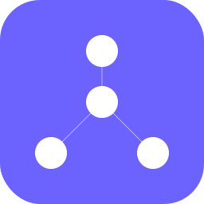
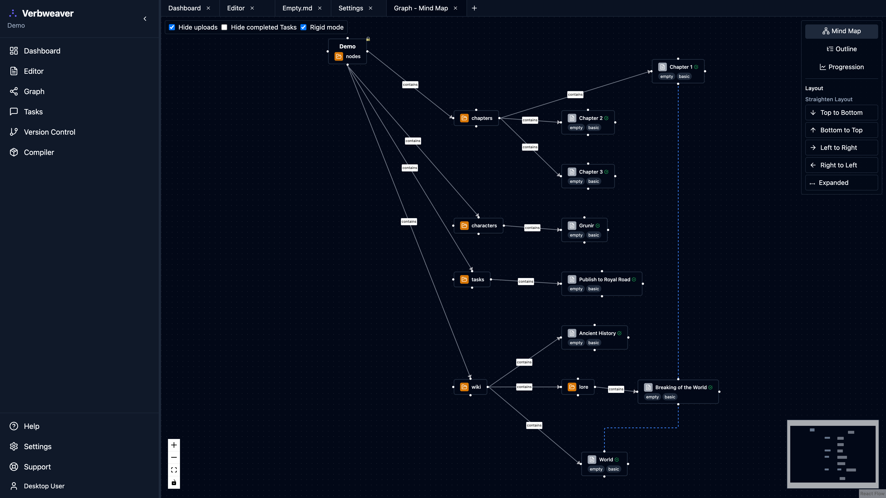

# Verbweaver



Verbweaver is a writing and design platform that thinks in relationships (graphs). It's designed for writers, artists, engineers, developers, analysts, and anyone who wants to design things while linking every idea together and turning those ideas into manageable tasks. Think and take notes in a way that is natural to you. Then, when it comes time to communicate your ideas or information to other people, use the Compiler and the powerful templating engine to generate a linear document in various common filetypes.

The desktop app is in beta. A web server version for teams is in development and not ready for use yet.



## Features

- **Graph:** see how your notes connect as a mind map, an outline, groups, or charts of the values in your notes.
- **Editor:** write in Markdown ([Pandoc's flavour](https://pandoc.org/MANUAL.html#pandocs-markdown)), with preview, links between notes, images and maths.
- **Tasks:** turn any note into a task, and track tasks on a Kanban board, a calendar, a to-do list, or Gantt and burndown charts.
- **Unified Data Model:** Everything is a node; a node is everything. A single file can be a written document, tracked as a Task, and visualized as a node on a graph. 
- **Compiler:** export your notes as PDF, Word, OpenDocument, EPUB, HTML or Markdown, with templates you can customise.
- **Version control:** every project is a Git repository, so you can save versions, go back to earlier ones, and sync with GitHub or another Git host.
- **Plain files:** your work is stored as Markdown files with a short details metadata block at the top, in a folder you choose. Use any other editor alongside Verbweaver.
- **Works offline:** the desktop app runs on Windows, macOS and Linux and needs no account.

## Install

Download the latest installer from the [Releases page](https://github.com/Verbweaver/verbweaver/releases):

- **Windows:** `Verbweaver-Setup-<version>.exe`
- **macOS:** `Verbweaver-v<version>-arm64.dmg` for Apple silicon, or `-x64.dmg` for Intel Macs
- **Linux:** `.AppImage`, `.deb` or `.rpm`

You'll also need [Git](https://git-scm.com/downloads). The tools for exporting documents (Pandoc and Tectonic) come with the app. The [Getting Started guide](docs/getting-started.md) walks through installing and creating your first project.

Builds downloaded from GitHub Actions runs are not signed. To open one on a Mac, clear the quarantine flag first: `xattr -dr com.apple.quarantine Verbweaver.app`

## Documentation

The guides in [docs/](docs/README.md) are also built into the app under **Help**. Developer and maintainer notes are in [dev-docs/](dev-docs/).

## Build from source

You need Node.js 22.13 or later, Python 3.11 to 3.13, and Git.

On macOS or Linux, one script installs everything and starts the desktop app in development mode:

```bash
git clone https://github.com/Verbweaver/verbweaver.git
cd verbweaver
./desktop/build-and-run.sh
```

On Windows, run `desktop\build-and-run.ps1` from PowerShell instead.

The script runs `npm ci`, creates a Python virtual environment in `.venv`, builds the shared package, starts the frontend dev server on port 3000, and launches Electron, which starts the backend itself. It uses `python3.13`, `python3.12` or `python3.11` if found; set `PYTHON=/path/to/python` to choose another. Optional settings: `SKIP_INSTALL=true` skips `npm ci`, `REINSTALL_BACKEND=true` re-runs `pip install`, `START_BACKEND=false` stops Electron starting the backend, and `KEEP_FRONTEND=true` leaves the dev server running after Electron exits.

To run the pieces by hand:

```bash
# One-time setup, from the repo root
npm ci
npm run build:shared
python3.13 -m venv .venv
.venv/bin/python -m pip install -r backend/requirements.txt

# Terminal 1: frontend dev server
cd frontend && npm run dev

# Terminal 2: desktop app (starts the backend from .venv)
cd desktop && NODE_ENV=development npm run dev
```

To run the backend separately, start it with `cd backend && ../.venv/bin/python -m uvicorn app.main:app --reload --port 8000` and launch the desktop app with `SKIP_BACKEND=true`.

Installers are built with electron-builder (`npm run dist:win`, `dist:mac` or `dist:linux` in `desktop/`). Release builds also bundle a PyInstaller build of the backend; see [the release checklist](dev-docs/RELEASE_CHECKLIST.md).

## Web server (in development)

The web version shares the frontend with the desktop app and adds accounts, sign-in with Google or GitHub, and passkeys. It isn't ready for use yet. To try it:

```bash
# Terminal 1: backend on port 8000
cd backend && ../.venv/bin/python -m uvicorn app.main:app --reload --port 8000

# Terminal 2: frontend on port 3000
cd frontend && npm run dev
```

`./start-dev.sh` (or `start-dev.ps1`) starts both. Configuration is read from environment variables or `backend/.env`; see [Install the server](docs/install-server.md) and [Deploy with Docker](docs/docker-deploy.md).

## Tests

The automated tests cover the backend. Install pytest into the virtual environment once, then run them:

```bash
.venv/bin/python -m pip install pytest
cd backend && ../.venv/bin/python -m pytest
```

Also run `npm run lint` and `npm run type-check` in `frontend/`, and `npm run typecheck` in `desktop/`. CI builds the shared package and frontend and runs the backend tests.

## Project layout

```
verbweaver/
├── assets/templates/   default page, compiler and project templates, bundled into the app
├── backend/            FastAPI backend (app/ is the application, tests/ the tests)
├── desktop/            Electron app (src/main.ts, src/preload.ts) and packaging resources
├── dev-docs/           developer and maintainer notes
├── docs/               user guides, also shown in the app's Help
├── frontend/           React + Vite frontend shared by desktop and web
├── shared/             TypeScript types and constants used by frontend and desktop
├── scripts/            maintenance scripts, such as Help screenshot capture
├── nginx/              reverse proxy config for the web server
└── docker-compose.yml  web server stack (in development)
```

## Contributing

Contributions are welcome. See [CONTRIBUTING.md](CONTRIBUTING.md).

## License

Verbweaver is licensed under the MIT License with the Commons Clause; see [LICENSE](LICENSE).

The MIT License lets you use, modify and redistribute Verbweaver free of charge. The Commons Clause forbids selling Verbweaver, or providing a service (such as cloud hosting) "whose value derives, entirely or substantially" from Verbweaver. To ask about a license exception, please contact us with your offer.

## Acknowledgments

- [Pandoc](https://pandoc.org/) converts documents between formats. It is a separate program that Verbweaver runs; it is not part of Verbweaver. The source code of the version Verbweaver uses is at https://github.com/jgm/pandoc/tree/3.8.1.
- [Tectonic](https://tectonic-typesetting.github.io/en-US/) typesets PDFs from a single program.
- [FastAPI](https://fastapi.tiangolo.com/), [React](https://react.dev/), [React Flow](https://reactflow.dev/), [Monaco Editor](https://microsoft.github.io/monaco-editor/), [Electron](https://www.electronjs.org/) and [GitPython](https://gitpython.readthedocs.io/).
- [FullCalendar](https://fullcalendar.io/) (core, daygrid), © Adam Shaw, [MIT License](https://fullcalendar.io/license/mit). Its CSS is included so the calendar works offline.
- Everyone who has contributed to or supported Verbweaver.

## Contact

- **Issues:** [GitHub Issues](https://github.com/Verbweaver/verbweaver/issues)
- **Discord:** [Join the community](https://discord.gg/aK3sBsBw)
- **Bluesky:** [@verbweaver.bsky.social](https://bsky.app/profile/verbweaver.bsky.social)
- **Email:** https://verbweaver.design/contact
