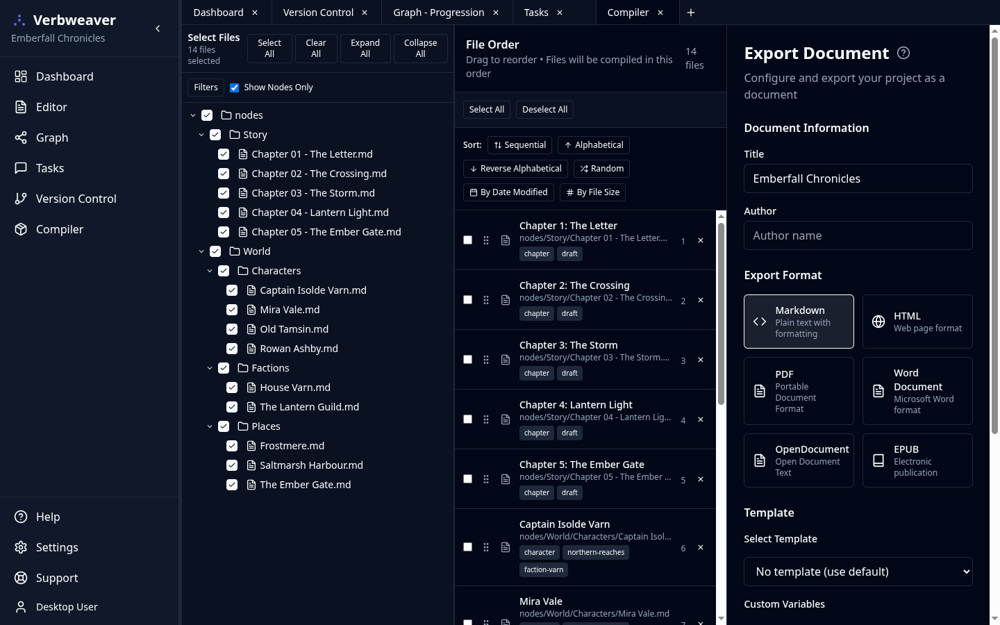

# Compiler

The Compiler (the **Export Document** page) turns pages from your project into one finished document, such as a manuscript, a report, or an e-book. Pick the pages, put them in order, choose a format, and export.

## 1. Choose your pages

In **Select Files** on the left, tick the pages to include. Ticking a folder includes everything inside it.

- **Select All** and **Clear All** help with large projects. They include pages in closed folders too.
- **Expand All** opens every folder, however deep.
- **Filters** narrows the list, for example to pages with a certain tag. To keep only certain folders, type them in **Path starts with**, such as `chapters`.

## 2. Put them in order

**File Order** in the middle lists your chosen pages in the order they'll appear in the document.

- Drag a page up or down to move it.
- Use the **Sort** buttons to reorder quickly, for example alphabetically. **By Date Modified** puts the least recently changed page first, and **By File Size** puts the smallest first. These two work in the desktop app only.
- To sort just some pages, tick them first. They're sorted among the places they already hold.
- To move several pages at once, tick them and click **Move to Top** or **Move to Bottom**. Or type a position in the **#** box and click **Move to #**. They keep their order and stay ticked, so you can move them again.
- Click **X** on a page to leave it out.

## 3. Choose how it looks

On the right:

- **Document Information:** enter the **Title** and **Author**. The title is also used as the file name.
- **Export Format:** pick Markdown, HTML, PDF, Word Document, OpenDocument, or EPUB.
- **Template** (optional): pick a ready-made layout if your project has one for that format. Some templates ask you to fill in extra details, such as a subtitle or a version number.
- **Options:** choose whether to include a table of contents, page details, and attached files such as images.
- **Font** (PDF, HTML, EPUB, Word and OpenDocument): the main font for the whole document. The list shows the fonts installed on your computer. If the template names a font, it's chosen for you. **Template default** keeps the template's font. When **Include metadata** is ticked, you can also pick a **Metadata font** for each page's Metadata section. See [Fonts](fonts.md).
- **Layout** (PDF and HTML): choose the page size (PDF only), font size, margins, and line spacing. **Template default** keeps whatever the template sets. Any other choice replaces the template's setting.

## 4. Export

Click **Compile and Download**. When it finishes, the desktop app asks where to save the document. In the web version, it goes wherever your browser saves downloads.

## Saving your setup

**Save Configuration** stores all your choices in a file. **Load Configuration** brings them back later, which is handy if you export the same document regularly.

## If something is missing

Exporting uses Pandoc and, for PDF, a PDF engine. Both come with the desktop app. If the Compiler shows a **Missing Dependencies** warning, see [Export Tools](dependency-checker.md).

## Learn more

Advanced: [Compiler Template System](compiler-template-system.md) explains how to build your own templates.
