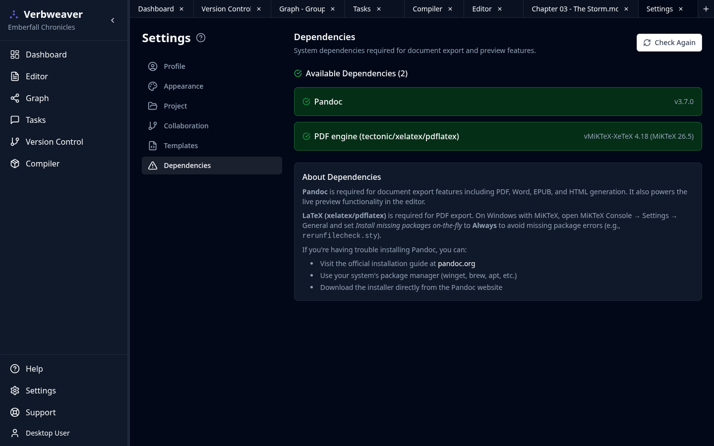

# Export Tools

The [Compiler](compiler.md) uses two free programs to turn your pages into finished documents:

- **Pandoc** converts your pages to every format, and also draws the Editor's preview.
- A **PDF engine** (Tectonic, which comes with Verbweaver, or a LaTeX program such as xelatex) is used when exporting to PDF.

Both come with the desktop app, so you normally don't need to install anything.

## Checking that they work

Open **Settings → Dependencies**. Each tool shows a green tick when it's ready, with "(using bundled)" if Verbweaver is using the copy it came with.

If a tool is missing, Verbweaver also shows a red **Missing Dependencies** button in the corner of the window, and a warning on the Compiler page.

## If a tool is missing

1. Click its **Install** button, such as **Install Pandoc**. This opens the tool's download page.
2. Install it and follow the installer's steps.
3. Back in Verbweaver, click **Check Again**. If it still isn't found, restart Verbweaver.

You can also install them from a terminal:

| Computer | Pandoc | PDF engine |
|---|---|---|
| Windows | `winget install pandoc` | [MiKTeX](https://miktex.org/download) |
| Mac | `brew install pandoc` | `brew install --cask mactex` |
| Debian, Ubuntu | `sudo apt install pandoc` | `sudo apt install texlive-xetex` |
| Fedora | `sudo dnf install pandoc` | `sudo dnf install texlive-xetex` |

With MiKTeX on Windows, open **MiKTeX Console → Settings → General** and set **Install missing packages on-the-fly** to **Always**. Otherwise some PDF exports stop with a "file not found" error.
