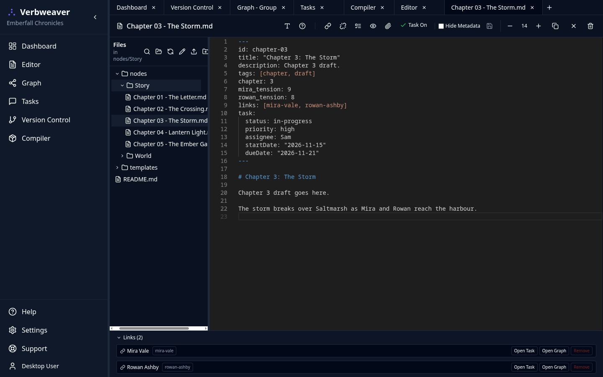

# Editor

The Editor is where you write. Each page is a Markdown file: plain text with a few symbols for formatting, such as `**bold**`. The list of files is on the left, and the page you're editing is on the right.



## Files

The **Files** list shows your project's folders and pages. Click a page to open it. Select a folder, then use the buttons at the top of the list to:

- **Create node in** the folder: add a new page, starting from a template.
- **Create folder in** the folder.
- **Rename** the selected page or folder.
- **Upload file(s)**, such as images or PDFs. They're stored in the project's `uploads` folder.
- **Find in Files**: search the text of every page.
- **Refresh files**: show changes made outside Verbweaver.

## The toolbar

Above the page:

- **Create link** (**Ctrl+Shift+L**): connect this page to another one. Links show up in the [Graph](graph-view.md) and in the list below the page. **Remove link(s)** takes them away.
- **See Task**: open this page's task details. **Task On / Task Off** chooses whether the page appears in [Tasks](tasks.md).
- **Toggle preview** (the eye icon, or **Ctrl+P**): see the page formatted, as it will look when exported. **Hide Metadata** hides the details block at the top.
- **Attach files**: add files, such as images, to this page.
- **Save** (**Ctrl+S**).
- Make the text smaller or larger, **Duplicate file**, **Close file**, or **Delete node**.

On a Mac, use **⌘** instead of **Ctrl**.

If you have unsaved changes, save them before you add or remove links or attachments, or switch the task on or off. Until you save, those buttons are greyed out.

## Links and attachments

Below the page are two lists you can open and close: **Links** shows the pages this one is linked to, and **Attachments** shows the files attached to it. The lists stay visible when **Hide Metadata** is on.

When you attach a file that's already in the project's `uploads` folder, Verbweaver uses that file instead of making a copy.

For each attached file you can:

- **Open File** in its usual app.
- **Show in Folder** to find it on your computer.
- **Unattach** it from this page. The file stays in the `uploads` folder.
- **Delete File** to remove it from your computer. If other pages have the same file attached, Verbweaver tells you which ones and removes it from them too.

Opening, showing and deleting files only work in the desktop app.

## Formatting your writing

Verbweaver uses [Pandoc Markdown](https://pandoc.org/MANUAL.html#pandocs-markdown). The basics:

```markdown
# Chapter title
## Section
### Subsection

*italic*  **bold**  ~~strikethrough~~

- A list item
- Another item
  - An item inside it

| Column A | Column B |
|----------|----------|
| A1       | B1       |
```

**Ctrl+B** makes the selected text bold, **Ctrl+I** makes it italic, and **Ctrl+K** inserts a link.

### Fonts

To put some words in a different font, wrap them in square brackets and name the font:

```markdown
She wrote [Dear Sir,]{font="Comfortaa"} at the top of the letter.
```

To change the font of whole paragraphs, put them between two `:::` lines:

```markdown
::: {font="Caladea"}
This paragraph is in Caladea.

So is this one.
:::
```

The font shows up when you export to PDF, HTML, EPUB, Word or OpenDocument. The Editor itself keeps its usual font. Use the font's name exactly as it appears in **Settings → Dependencies → Fonts**. See [Fonts](fonts.md) for installing new fonts.

## Linking to other pages

The easiest way to connect pages is **Create link**. You can also write a link in the text:

```markdown
[Previous chapter](../chapter-1.md)
[The hero](/nodes/characters/hero.md)
[The final battle](chapter-10.md#the-final-battle)
```

- A path without a leading `/` starts from the current page's folder; `..` means "the folder above".
- A path starting with `/` starts from the project's main folder.
- `#` and a heading jumps to that heading. Write the heading in lower case with hyphens for spaces: `# The Final Battle` becomes `#the-final-battle`.

**Ctrl+Click** a link in the Editor to open the page it points to; if you have unsaved changes, Verbweaver asks first. In the preview, just click it.

## Images

Put the image in your project, for example with **Upload file(s)**, then link to it with an exclamation mark in front:

```markdown

```

## Maths

Write formulas between dollar signs. They show in the preview and in exported documents.

```markdown
Inline: the mass-energy relation is $E = mc^2$.

On its own line:
$$
\sum_{i=1}^n i = \frac{n(n+1)}{2}
$$
```

Formulas inside code (between backticks) aren't formatted. Exporting to PDF works without installing anything else.

## The details block

Every page can start with a block of details between two `---` lines. Verbweaver uses it to store the page's title, links, tags and task information, and you can add your own details, such as a chapter number. The [Graph](graph-view.md) uses them for groups and charts.

```yaml
---
id: node-123
title: Chapter 1
tags: [draft]
links:
  - node-abc
  - nodes/Characters/Alice.md
chapter: 1
task:
  tracked: true
---
```

- `title`: the name shown in the Graph and in lists.
- `links`: other pages this one links to, by their ID or by their path in the project (`.md` can be left off). **Create link** fills this in for you.
- `task.tracked`: whether the page appears in Tasks. **Task On / Task Off** changes it.

Keep the `id` line as it is; Verbweaver uses it to keep links working when pages move.
