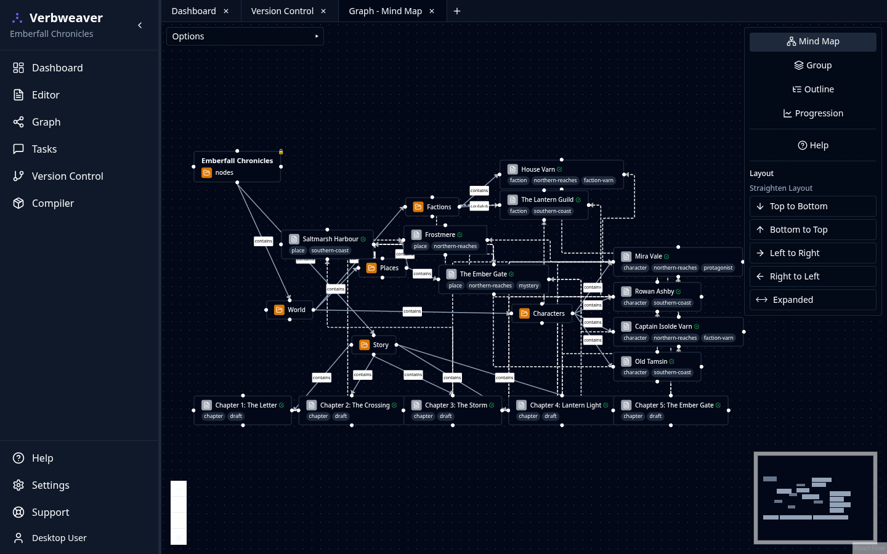
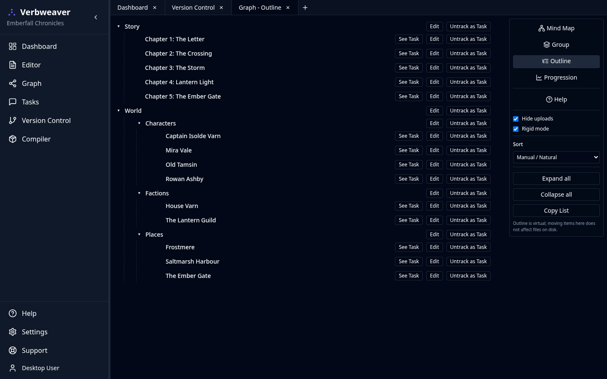
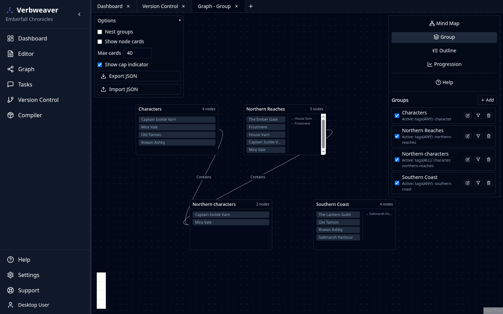
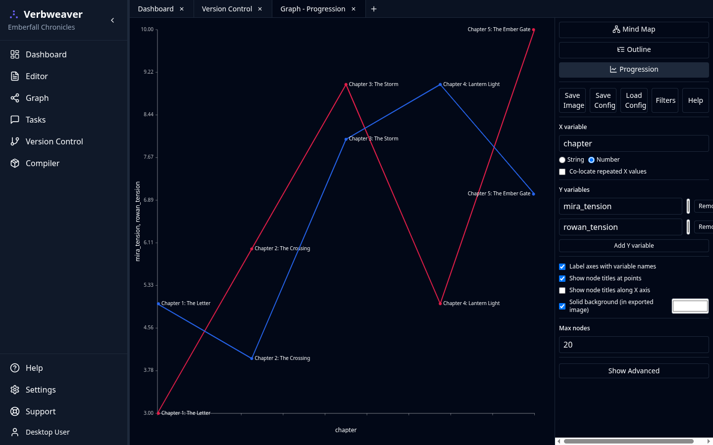

# Graph View

The Graph view shows your whole project and how its pages connect. It has four views. Switch between them with the buttons at the top right, and click **Help** there to jump to the section for the view you're in.

- [Mind Map](#mind-map): a board of cards you can arrange freely and link together. Good for brainstorming and seeing relationships.
- [Outline](#outline): an indented list, like a table of contents. Good for planning structure and running order.
- [Group](#group): named collections of pages shown as boxes. Good for comparing sets, such as acts, characters, or drafts.
- [Progression](#progression): a line chart built from details on your pages. Good for tracking things like pacing or a character's arc.

## Mind Map

The Mind Map shows every page in your project as a card on a board, with lines for the links between them. Use it to see how characters, places, chapters, and ideas connect, and to arrange them in a way that makes sense to you.



### Moving around

- Drag empty space to move the board. Use the zoom buttons in the corner, or your mouse wheel, to zoom.
- The small map in the corner shows where you are on large boards.

### Arranging cards

- Drag a card to move it. While **Rigid mode** is on, cards stay where you put them.
- To tidy up automatically, pick a direction under **Layout** on the right, such as **Top to Bottom**.
- To pin a card in place, right-click it and choose **Lock position**.
- To fold a folder's contents away, right-click the folder and choose **Collapse**.

### Selecting several cards

- Hold **Shift** and drag across the board to draw a box around cards.
- Hold **Shift** or **Ctrl** (**⌘** on Mac) and click cards to add or remove them from the selection.

### Linking pages

Drag from one of the small dots on a card's edge to another card. This connects the two pages, for example a character to a scene they appear in.

To remove a link, right-click the line and choose **Unlink**.

### Right-click menus

- **On empty space:** create a folder, upload a file, create a new page from a template, or save the map as a picture.
- **On a page:** edit it, link it to other pages, attach files, track it as a task, or delete it.
- **On a folder:** create pages or folders inside it, collapse it, or delete it.

### Options (top left)

- **Hide uploads:** hides files you've uploaded, such as images.
- **Hide completed Tasks:** hides pages whose tasks are done.
- **Display one-way links:** shows links that only point one way, as dashed arrows.
- **Filters:** shows only the pages you want, for example those with a certain tag.

### Shortcuts

- **Delete:** delete the selected cards. You'll be asked to confirm.
- **Esc:** clear the selection.
- **U:** show or hide uploads.
- **A:** turn Rigid mode on or off.

## Outline

The Outline lists your project's pages as a tidy, indented list, like a table of contents. Use it to plan the structure of your work, such as the running order of chapters and scenes.

Changes here only affect how the list is arranged. Your actual files are never moved.



### Reading the list

- Click **▸** next to a folder to open it, or **▾** to close it.
- **Expand all** and **Collapse all** open or close every folder at once.
- Each page has buttons to **Edit** it, see its task, or start or stop tracking it as a task.

### Rearranging

1. Untick **Rigid mode**. Rearranging is switched off while it's on.
2. Drag a page above or below another. A line shows where it will land.
3. Drop a page onto an open folder to move it into that folder.

### Sorting

1. Choose an order from **Sort**, such as **Alphabetical**. You'll see a preview.
2. Click **Apply & Save** to keep it, or **Clear** to cancel the preview.

**Virtual Group: Relationships** places linked pages next to each other.

### Other options

- **Hide uploads:** hides files you've uploaded, such as images.
- **Copy List:** copies the outline as a bulleted list, ready to paste into notes or an email.

## Group

The Group view sorts your pages into named collections and shows them as boxes, so you can compare them at a glance. For example, you could make groups for "Act One", "Main characters", or "Needs revision" and see which pages belong to more than one.



### Making a group

1. Click **Add** on the right. A new group starts out containing every page.
2. Click the funnel icon to choose which pages belong in it, for example everything tagged "villain".
3. Click the pencil icon to give it a name.

Use the checkbox next to a group to show or hide it. The bin icon deletes the group, but your pages are not affected.

### Reading the boxes

- Each box shows the group's name and how many pages it holds.
- If one group is entirely inside another, an arrow points from the larger group to the smaller one.
- Groups with exactly the same pages share a single box with a dotted border.
- Drag a box to move it. Its position is remembered.

### Options (top left)

- **Nest groups:** draws smaller groups inside the larger groups that contain them.
- **Show node cards:** shows full page cards instead of a simple list of titles.
- **Max cards:** limits how many cards each box shows, which keeps large groups tidy.
- **Export JSON / Import JSON:** saves your groups to a file, or loads them back.

### Working with pages

- With **Show node cards** on, drag from the dot on one card to another to link those pages.
- Right-click a card to edit it, link it, attach files, or delete it. Deleting here happens straight away, without asking to confirm.
- Right-click a link line to **Unlink** it.

### Saving a picture

Right-click empty space and choose **Save as PNG...**.

Your groups are remembered on this computer for this tab.

### Example: lore for a fictional world

Say you're building a fantasy world and you've tagged each lore article. Tags might be "character", "place", or "faction", plus the region it belongs to, such as "northern-reaches".

1. Make a group called **Characters**. Set its filter to the tag `character`.
2. Make a group called **Northern Reaches**. Set its filter to the tag `northern-reaches`.
3. Make a group called **Northern characters**. Set its filter to the tags `character, northern-reaches` and set **Match:** to **ALL**, so only articles with both tags are included.

An arrow now points from **Characters** and from **Northern Reaches** to **Northern characters**, because it sits inside both. Turn on **Nest groups** to see it drawn inside them instead. At a glance you can see who lives where, and spot any character you forgot to place in a region.

### Example: IT network documentation

Say you document your organisation's network, with one page per server, database, or firewall. Each page is tagged with what it is and where it runs, such as "database" and "production".

1. Make a group called **Production**. Set its filter to the tag `production`.
2. Make a group called **Staging**. Set its filter to the tag `staging`.
3. Make a group called **Production databases**. Set its filter to the tags `production, database` with **Match:** set to **ALL**.
4. Make a group called **Firewalls**. Set its filter to the tag `firewall`.

You can now see which resources belong to each environment, which databases are in production, and where your firewalls sit. If a page shows up in both **Production** and **Staging**, it may be tagged by mistake, or it may be shared between them, which is worth knowing either way.

## Progression

The Progression view draws a line chart from details you've recorded on your pages. Use it to see how something changes across your work, for example a character's mood across chapters or the tension level from scene to scene.



### Before you start

Add the details to your pages first. For example, give each chapter page a `chapter` number and a `tension` score. These are the values the chart will plot.

Details go in the block at the very top of a page, between the two `---` lines. Open the page in the Editor and add one detail per line, as `name: value`. Write numbers on their own, without quotes. The [Editor guide](editor.md) has more about this block.

### Making a chart

1. In **X variable**, type the detail to run along the bottom, such as `chapter`.
   - Choose **Number** if the values are numbers, or **String** if they are words.
2. Click **Add Y variable** and type a detail to plot, such as `tension`.
   - Pick a colour for its line.
   - Add more lines the same way.
3. Hover over a point to see its value and page title.

### Choosing which pages appear

- **Filters** narrows the chart to certain pages, for example those tagged "draft".
- **Show Advanced** lets you tick specific pages. Turn on **Use manual ordering** to drag pages into the order you want.
- **Max nodes** limits how many pages are plotted.

### Labels

You can show variable names on the axes, and page titles at each point or along the bottom.

### Saving

- **Save Image** saves the chart as a picture. Untick **Solid background** for a transparent background.
- **Save Config** saves your chart settings to a file. **Load Config** brings them back.

### If a page is missing

- Check that the page has a number for each detail you're plotting.
- Check that the detail names match exactly, including spelling.
- If titles overlap, turn off **Show node titles along X axis**, or plot fewer pages.

### Example: a character's tension across chapters

Say you want to see how tense things get for two characters, Mira and Rowan, as your story goes on.

**1. Add the details to each chapter page.** Give every chapter its number and a tension score from 0 (calm) to 10 (unbearable) for each character:

```yaml
---
title: "Chapter 1: The Letter"
tags: [chapter]
chapter: 1
mira_tension: 3
rowan_tension: 5
---
```

```yaml
---
title: "Chapter 2: The Crossing"
tags: [chapter]
chapter: 2
mira_tension: 6
rowan_tension: 4
---
```

```yaml
---
title: "Chapter 3: The Storm"
tags: [chapter]
chapter: 3
mira_tension: 9
rowan_tension: 8
---
```

**2. Set up the chart.**

- **X variable:** `chapter`, with **Number** selected.
- **Add Y variable:** `mira_tension`, and pick a colour.
- **Add Y variable** again: `rowan_tension`, with a different colour.
- **Filters:** show only pages tagged `chapter`.
- Optionally tick **Show node titles at points** to see chapter names on the chart.

**3. Read it.** Each line is one character's arc. Look for steady climbs, sudden drops, and chapters where the two lines cross, which are often turning points in the story. A long flat stretch may mean the pacing sags there.

### Example: a plant growth experiment

Say you're running a study and recording one observation page per week for a plant.

**1. Add the details to each observation page:**

```yaml
---
title: Week 1 observation
tags: [observation, sunlight]
week: 1
height_cm: 4.2
leaf_count: 3
---
```

```yaml
---
title: Week 2 observation
tags: [observation, sunlight]
week: 2
height_cm: 6.8
leaf_count: 5
---
```

**2. Set up the chart.**

- **X variable:** `week`, with **Number** selected.
- **Y variables:** `height_cm` and `leaf_count`, each with its own colour.
- **Filters:** show only pages tagged `observation`.

**3. Use it.** The lines show how fast the plant grows and when it puts out new leaves.

- To compare conditions, tag pages `sunlight` or `shade`. Filter to one tag and click **Save Config**, then switch to the other.
- Click **Save Image** to put the chart into your report.
