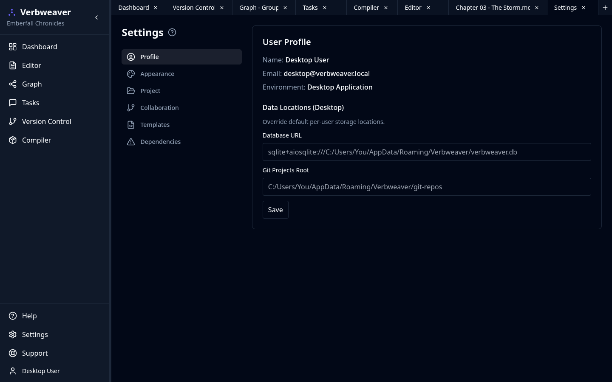
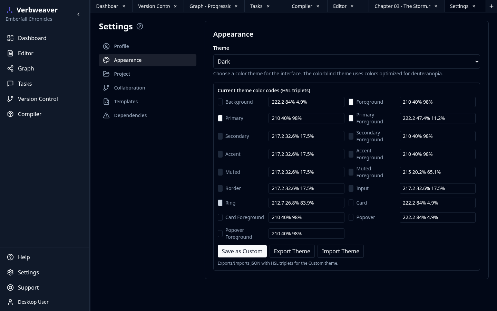
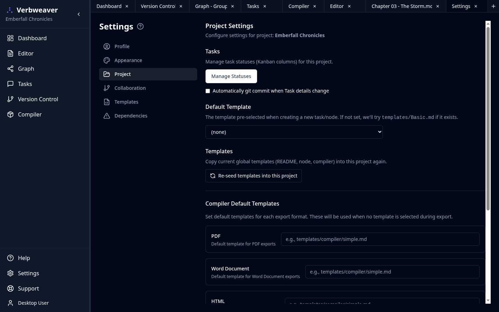
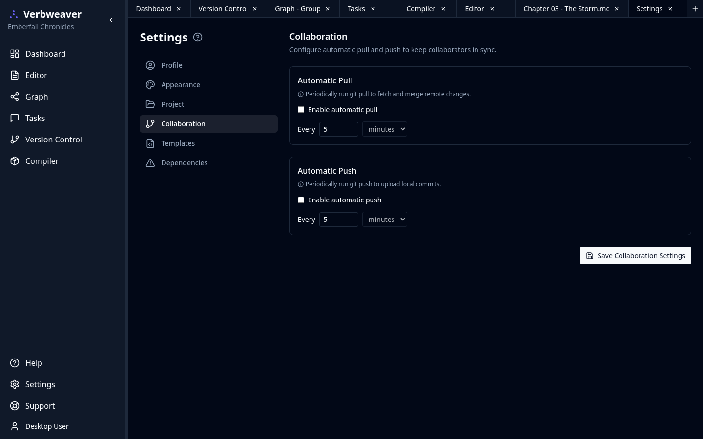
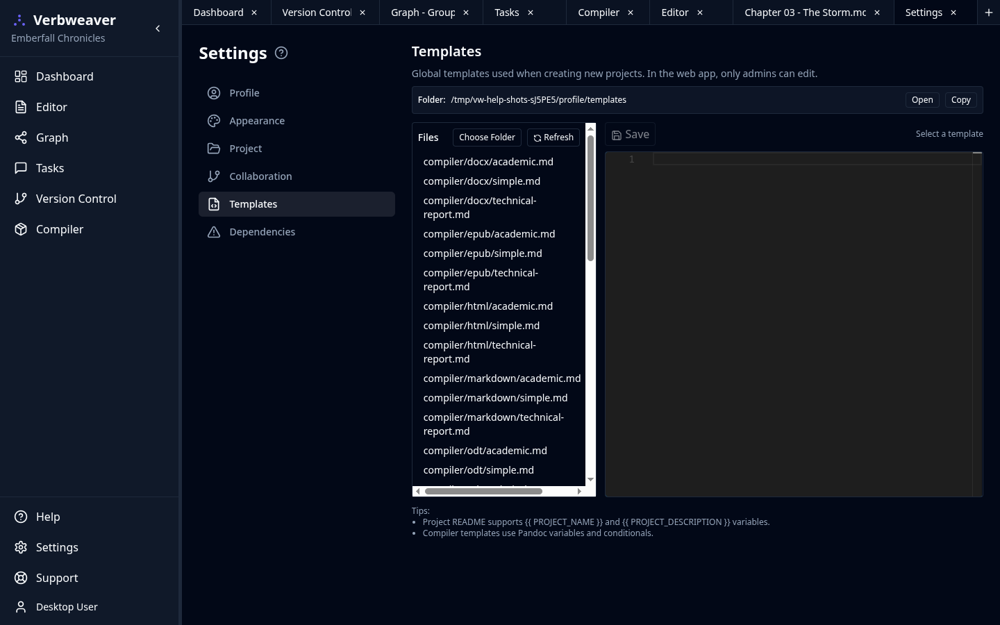
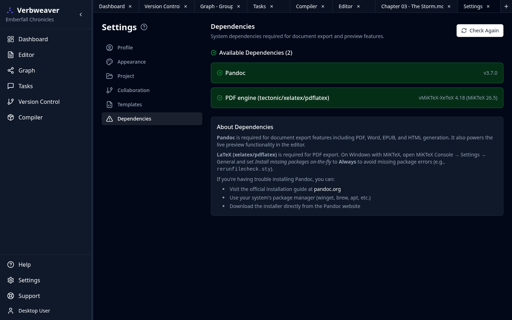

# Settings

Settings is where you adjust how Verbweaver looks and behaves. Pick a section from the list on the left. Most changes take effect straight away.

## Profile

Shows who you're signed in as.

In the desktop app, **Data Locations** lets you choose where Verbweaver keeps its information and your project folders. Click **Save**, then **restart the app** for the change to take effect. Most people never need to change these.

## Appearance

Choose a **Theme**: Light, Dark, High Contrast, Colorblind Friendly, or Custom. The change applies immediately.

To make your own colour scheme:

1. Edit the colour values in the list. The swatch next to each one shows the colour.
2. Click **Save as Custom**.
3. Use **Export Theme** to save it to a file, and **Import Theme** to load one, for example a theme shared by a colleague.

## Security

Web version only. Set up **passkeys**, which let you sign in with your fingerprint, face, or device PIN instead of a password.

- Click **Add New Passkey** and follow your device's prompts.
- To remove a passkey you no longer use, click its bin icon.

## Project

Settings for the project you have open.

- **Manage Statuses:** sets up the task columns, such as To Do and Done. This is the same as **Manage Columns** on the [Tasks](tasks.md) page.
- **Automatically git commit when Task details change:** saves a version of your project every time you edit a task, so you never lose a change. See [Version Control](version-control.md).
- **Default Template:** the starting layout used when you create a new page or task.
- **Re-seed templates into this project:** replaces this project's templates with fresh copies of the standard ones. Any changes you've made to the project's templates will be overwritten.
- **Compiler Default Templates:** the layout used for each export format when you don't pick one on the [Compiler](compiler.md) page. Click **Save Compiler Settings** after changing these.

## Collaboration

Keeps your project in sync with an online copy when you work with others or on several computers.

- **Automatic Pull:** regularly brings in changes made elsewhere.
- **Automatic Push:** regularly sends your saved versions to the online copy.

Tick either one, choose how often (in seconds, minutes, or hours), then click **Save Collaboration Settings**. See [Version Control](version-control.md) for more about pulling and pushing.

## Templates

Templates are the starting layouts given to every **new** project. Existing projects keep their own copies.

- Click a file in the **Files** list to open it, make your changes, then click **Save**.
- Desktop app only: the **Folder** bar shows where templates are kept. **Open** shows the folder, and **Choose Folder** picks a different one.
- Web version: only administrators can change templates.

Advanced: [Compiler Template System](compiler-template-system.md) explains how export templates work.

## Dependencies

Desktop app only. Shows whether the extra software needed to export documents is installed:

- **Pandoc**, used for all export formats and previews;
- a **PDF engine**, used for exporting to PDF.

If something is missing, click its **Install** button and follow the installer. Then click **Check Again**. See the [Compiler](compiler.md) guide for more about exporting.
